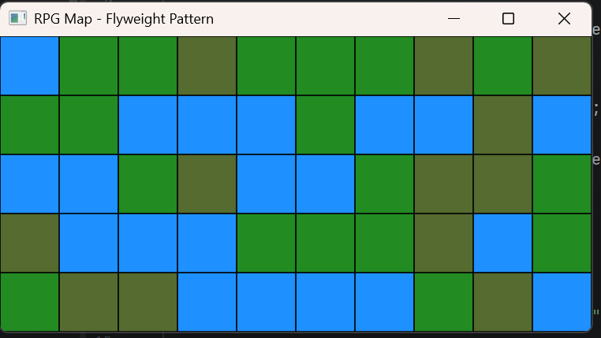

# Flyweight Pattern - RPG Map Generator

## Introduction

This is my Java project for the Flyweight Design Pattern assignment.

I used my previous Factory Method RPG Map Generator project and added graphical rendering using JavaFX.

The Flyweight Pattern helps reduce memory usage by sharing images between tiles of the same type.

## Original Project

I used my previous Factory Method project:

https://github.com/Minoo-YH/Java-map-generator

The original project generates random City and Wilderness maps and displays them in the console.

## Project Structure

The main classes are:

- `Game.java` - Starts the JavaFX application.
- `Map.java` - Stores the map and its tiles.
- `Tile.java` - Interface for different tile types.
- `CityMap.java` - Creates a random city map.
- `WildernessMap.java` - Creates a random wilderness map.
- `TileGraphicFactory.java` - Creates and shares tile images.
- `MapRenderer.java` - Draws the map using JavaFX Canvas.

The project includes five tile types: Forest, Water, Swamp, Road, and Building.

## New Functionality

I added `TileGraphicFactory` to manage shared tile images.

Each tile type has its own color. The factory creates an image only once for each type and reuses it when needed.

I also added `MapRenderer` to draw the map on a JavaFX Canvas.

I updated `Game.java` to open a JavaFX window instead of only displaying the map in the console.

## How to Run

I used Java 21, Maven, JavaFX, and IntelliJ IDEA.

Open a terminal in the project folder.

**Step 1: Compile the project**

```bash
mvn clean compile
```

**Step 2: Run the application**

```bash
mvn javafx:run
```

A window will open and display a random RPG map.

## Screenshot

The screenshot below shows the RPG map rendered using JavaFX.



## Testing

I compiled and ran the application using Maven.

The graphical map was displayed successfully.

I also tested whether two requests for the same tile image return the same object.

Example output:

```text
Shared images: 3
Same image: true
```

This shows that the Flyweight Pattern reuses shared images instead of creating a new image for every tile.

## Conclusion

In this project, I learned how to use the Flyweight Design Pattern with JavaFX.

I extended my previous Factory Method project by adding graphical map rendering.

The Flyweight Pattern helped me share tile images and reduce unnecessary object creation.

